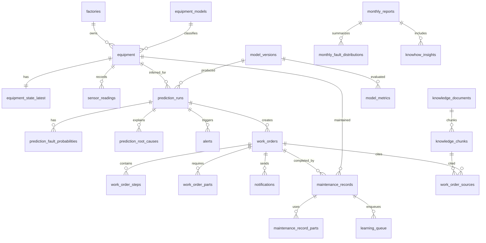

# 공장지기 백엔드 DB 설계 및 API 명세서

작성일: 2026-05-18  
대상 백엔드: Python FastAPI + PostgreSQL + pgvector  
범위: DB 설계, API 명세, 프론트엔드 연동 계약

## 1. 설계 근거

이 문서는 다음 파일을 기준으로 작성했다.

- `docs/공장지기_프로젝트_컨텍스트.md`
- `docs/공장지기_MVP_기획서_(양식적용).pdf`
- `docs/공장지기_본선_QA_답변_마스터.pdf`
- `src/App.tsx`
- `src/types/index.ts`
- 과거 정적 데이터 파일(`src/data/*`)은 제거되었고, 현재 프론트는 백엔드 API를 직접 조회한다.
- `src/pages/Dashboard.tsx`
- `src/pages/EquipmentDetail.tsx`
- `src/pages/WorkOrder.tsx`
- `src/pages/ResultForm.tsx`
- `src/pages/KnowHowReport.tsx`
- `src/components/*`

PDF 2개는 로컬 환경에 PDF 텍스트 추출기가 설치되어 있지 않아 원문 텍스트를 안정적으로 파싱하지 못했다. 대신 `공장지기_프로젝트_컨텍스트.md`가 두 PDF의 핵심 기획, Q&A, 기술 구조를 포함하고 있으므로 이를 주 근거로 삼았다.

## 2. 핵심 도메인 요약

공장지기는 설비 센서 데이터로 RUL과 72시간 내 고장 위험도를 추정하고, 추정 근거를 매뉴얼 기반 작업지시서로 변환한 뒤, 정비 결과를 다시 학습 데이터로 축적하는 폐쇄 루프 플랫폼이다.

프론트엔드 화면은 다음 백엔드 기능을 요구한다.

| 화면 | 필요한 데이터/API |
|---|---|
| 메인 대시보드 | 설비 목록, 최신 센서값, 상태별 설비 수, 위험 설비 알림, 월 가동률 |
| 설비 상세 | 설비 기본 정보, 최신 RUL/위험도, 근거 센서, 센서 히스토리, RUL 히스토리, 정비 이력 |
| 작업지시서 | AI #2 작업지시서 생성, RAG 출처, 절차, 필요 부품, 승인, 전송 |
| 결과 입력 | 정비 결과 저장, 실제 고장 유형 라벨, 학습 큐 적재 |
| 노하우 리포트 | 월별 비계획 정지, 예방 정비 건수, MTTR, 고장 유형 분포, AI 인사이트, 추출 지식 |

MVP에서 제외된 것은 다중 사용자 권한 관리, 실제 IoT 하드웨어 연동, ERP/MES 연동, 자동 재학습 파이프라인이다. 따라서 DB는 단일 공장 운영을 기본으로 하되, 이후 확장을 막지 않을 정도의 공장/사용자 테이블만 둔다.

## 3. 주요 가정

- DBMS는 PostgreSQL 16 이상을 기준으로 한다.
- RAG 검색을 위해 `pgvector` 확장을 사용한다.
- 센서 스트림은 MVP에서는 프론트가 보내지 않는다. 백엔드 `POST /api/v1/simulation/tick`이 가상 센서값을 생성하고, 같은 흐름에서 추론까지 실행한다.
- 향후 실제 IoT/CSV 스트림 연동 시 `POST /api/v1/sensor-readings/bulk`를 추가해 외부 센서값을 수집한다.
- Gemini API 호출 결과는 항상 DB에 저장해 재현성과 시연 안정성을 확보한다.
- 카카오톡 전송은 MVP에서는 데모 전송 기록만 남긴다. 실제 비즈메시지 API 연동은 `notifications.provider_message_id`로 확장한다.
- 인증/권한은 MVP 범위 밖이다. 단, 담당자/정비기사/수신자 기록을 위해 `users`는 둔다.

## 4. 상태값과 코드값

| 구분 | 값 |
|---|---|
| equipment_status | `normal`, `warn`, `danger` |
| maintenance_type | `preventive`, `emergency`, `inspection`, `part_replacement` |
| maintenance_result | `restored`, `partial_improved`, `part_required`, `reserved`, `normal` |
| fault_type_code | `normal`, `bearing_fault`, `belt_loose`, `rotor_unbalance`, `shaft_misalignment`, `hydraulic_seal`, `other` |
| alert_status | `open`, `acknowledged`, `resolved`, `dismissed` |
| work_order_status | `draft`, `generated`, `approved`, `sent`, `completed`, `cancelled` |
| notification_channel | `kakao_demo`, `kakao_biz`, `web` |
| learning_status | `queued`, `labeled`, `exported`, `trained`, `skipped` |

프론트 표시명은 API에서 `label`을 함께 내려주거나 프론트 매핑으로 처리한다.

## 5. DB 설계

### 5.1 관계 개요



### 5.2 테이블 상세

#### factories

단일 공장 MVP라도 화면에 "현재 공장: 시화공단 사출성형"이 존재하므로 공장 정보를 별도 테이블로 둔다.

| 컬럼 | 타입 | 설명 |
|---|---|---|
| id | bigint PK | 공장 ID |
| name | varchar(100) | 예: 시화공단 사출성형 |
| address | varchar(255) | 예: 경기도 시흥시 |
| industry | varchar(100) | 예: 자동차 부품 사출성형 |
| target_uptime_pct | numeric(5,2) | 목표 가동률, 기본 95.00 |
| target_delay_pct | numeric(5,2) | 목표 납기 지연율, 기본 2.00 |
| created_at | timestamptz | 생성 시각 |
| updated_at | timestamptz | 수정 시각 |

#### users

권한 시스템은 제외하지만 작업자, 관리자, 정비 담당자, 카카오 수신자 정보를 저장한다.

| 컬럼 | 타입 | 설명 |
|---|---|---|
| id | bigint PK |
| factory_id | bigint FK |
| name | varchar(50) | 예: 김영수, 이민준, 박영수 |
| role | varchar(30) | `manager`, `technician`, `operator` |
| phone | varchar(30) nullable |
| is_active | boolean |
| created_at | timestamptz |

#### equipment_models

설비 모델별 기본 사양과 센서 임계값의 기본값을 둔다.

| 컬럼 | 타입 | 설명 |
|---|---|---|
| id | bigint PK |
| maker | varchar(80) nullable |
| model_name | varchar(80) | 예: LS240-B |
| category | varchar(50) | 예: injection_molding |
| default_thresholds | jsonb | 진동/온도/전류/유압 기준 |
| manual_notes | text nullable |
| created_at | timestamptz |

`default_thresholds` 예:

```json
{
  "vibration_rms_g": { "warn": 1.5, "danger": 3.0 },
  "hydraulic_temp_c": { "warn": 75, "danger": 88 },
  "motor_current_a": { "warn": 25, "danger": 30 },
  "hydraulic_pressure_bar": { "warn": 150, "danger": 160 }
}
```

#### equipment

정적 설비 정보만 저장한다. RUL, 위험도, 최신 센서값은 `equipment_state_latest`에 둔다.

| 컬럼 | 타입 | 설명 |
|---|---|---|
| id | bigint PK |
| factory_id | bigint FK |
| model_id | bigint FK |
| name | varchar(80) | 예: 3호 사출기 |
| serial_no | varchar(80) nullable |
| installed_year | int | 예: 1996 |
| assigned_user_id | bigint FK nullable |
| cumulative_runtime_hours | numeric(12,1) nullable |
| thresholds_override | jsonb nullable | 설비별 임계값 오버라이드 |
| is_active | boolean |
| created_at | timestamptz |
| updated_at | timestamptz |

#### equipment_state_latest

대시보드와 설비 상세 상단 카드가 바로 소비하는 최신 상태 캐시다. 센서 수집, 추론, 정비 결과 입력 시 갱신한다.

| 컬럼 | 타입 | 설명 |
|---|---|---|
| equipment_id | bigint PK, FK |
| status | equipment_status |
| rul_hours | int nullable |
| rul_lower_hours | int nullable |
| rul_upper_hours | int nullable |
| risk_pct | numeric(5,2) |
| fault_type_code | fault_type_code nullable |
| fault_confidence_pct | numeric(5,2) nullable |
| vibration_rms_g | numeric(8,3) nullable |
| hydraulic_temp_c | numeric(8,2) nullable |
| motor_current_a | numeric(8,2) nullable |
| hydraulic_pressure_bar | numeric(8,2) nullable |
| last_maintenance_at | date nullable |
| next_plan_text | varchar(120) nullable |
| latest_prediction_run_id | bigint FK nullable |
| latest_sensor_reading_at | timestamptz nullable |
| updated_at | timestamptz |

#### sensor_readings

시뮬레이터 또는 향후 IoT 수집 데이터의 원천 테이블이다. 프론트 현재 요구는 4개 센서지만 C-MAPSS/AI Hub 21변수 입력 가능성을 위해 `features`를 함께 둔다.

| 컬럼 | 타입 | 설명 |
|---|---|---|
| id | bigint PK |
| equipment_id | bigint FK |
| measured_at | timestamptz |
| cycle_no | bigint nullable | C-MAPSS/시뮬레이터 사이클 |
| vibration_rms_g | numeric(8,3) nullable |
| hydraulic_temp_c | numeric(8,2) nullable |
| motor_current_a | numeric(8,2) nullable |
| hydraulic_pressure_bar | numeric(8,2) nullable |
| features | jsonb nullable | 21변수 등 모델 입력 전체 |
| source | varchar(30) | `simulator`, `manual`, `iot` |
| created_at | timestamptz |

권장 인덱스:

- `(equipment_id, measured_at desc)`
- `(measured_at desc)`
- `GIN (features)`
- 월 단위 파티셔닝: 데이터가 커지면 `measured_at` 기준 range partition

#### sensor_anomalies

설비 상세의 "센서 이상 시각"과 알림 근거로 사용한다.

| 컬럼 | 타입 | 설명 |
|---|---|---|
| id | bigint PK |
| equipment_id | bigint FK |
| sensor_reading_id | bigint FK nullable |
| detected_at | timestamptz |
| sensor_name | varchar(50) |
| value_numeric | numeric(12,4) |
| unit | varchar(20) |
| level | equipment_status | `warn`, `danger` 중심 |
| threshold_value | numeric(12,4) nullable |
| message | text |

#### model_versions

RUL 회귀, 고장 분류, 통합 추론에 사용된 모델 버전을 저장한다.

| 컬럼 | 타입 | 설명 |
|---|---|---|
| id | bigint PK |
| model_key | varchar(80) | `rul_lstm_fd001`, `fault_1dcnn_aihub238` |
| version | varchar(40) |
| model_type | varchar(30) | `rul_regression`, `fault_classification`, `integrated` |
| dataset_name | varchar(120) |
| artifact_uri | text nullable |
| is_active | boolean |
| trained_at | timestamptz nullable |
| created_at | timestamptz |

#### model_metrics

설비 상세 RUL 탭의 AI 모델 성능을 제공한다.

| 컬럼 | 타입 | 설명 |
|---|---|---|
| id | bigint PK |
| model_version_id | bigint FK |
| metric_name | varchar(80) | `rmse_cycles`, `phm_score`, `miss_rate_pct`, `false_maintenance_pct` |
| metric_value | numeric(12,4) |
| display_value | varchar(80) | 예: 14.2 cycles |
| evaluated_at | timestamptz |

#### prediction_runs

AI #1 추정 결과의 중심 테이블이다.

| 컬럼 | 타입 | 설명 |
|---|---|---|
| id | bigint PK |
| equipment_id | bigint FK |
| model_version_id | bigint FK nullable |
| input_window_start | timestamptz nullable |
| input_window_end | timestamptz nullable |
| input_readings_count | int |
| status | equipment_status |
| rul_hours | int |
| rul_lower_hours | int |
| rul_upper_hours | int |
| risk_pct | numeric(5,2) |
| fault_type_code | fault_type_code nullable |
| fault_confidence_pct | numeric(5,2) nullable |
| summary | text nullable |
| raw_output | jsonb nullable |
| created_at | timestamptz |

권장 인덱스:

- `(equipment_id, created_at desc)`
- `(status, created_at desc)`
- `(risk_pct desc)`

#### prediction_fault_probabilities

고장 유형별 분류 확률을 저장한다.

| 컬럼 | 타입 | 설명 |
|---|---|---|
| id | bigint PK |
| prediction_run_id | bigint FK |
| fault_type_code | fault_type_code |
| probability_pct | numeric(5,2) |

유니크 제약: `(prediction_run_id, fault_type_code)`

#### prediction_root_causes

Feature Importance/Attention 결과를 저장한다.

| 컬럼 | 타입 | 설명 |
|---|---|---|
| id | bigint PK |
| prediction_run_id | bigint FK |
| sensor_name | varchar(80) | 예: 진동 RMS |
| importance_pct | numeric(5,2) | 예: 31.00 |
| direction | varchar(20) | `increase`, `decrease`, `variance` |
| display_text | varchar(120) | 예: 진동 RMS 31%↑ |
| rank_no | int |

#### alerts

위험/경고 설비 알림을 저장한다.

| 컬럼 | 타입 | 설명 |
|---|---|---|
| id | bigint PK |
| equipment_id | bigint FK |
| prediction_run_id | bigint FK nullable |
| level | equipment_status |
| status | alert_status |
| title | varchar(160) |
| message | text |
| opened_at | timestamptz |
| acknowledged_at | timestamptz nullable |
| resolved_at | timestamptz nullable |

#### knowledge_documents

RAG 원천 문서다. 설비 매뉴얼 PDF, 사내 SOP, 과거 정비 이력 요약을 모두 문서로 취급한다.

| 컬럼 | 타입 | 설명 |
|---|---|---|
| id | bigint PK |
| factory_id | bigint FK |
| title | varchar(200) |
| document_type | varchar(30) | `manual`, `sop`, `maintenance_case` |
| equipment_model_id | bigint FK nullable |
| file_name | varchar(255) nullable |
| file_uri | text nullable |
| source_label | varchar(200) | 예: 설비 운영 매뉴얼 §4.3 |
| uploaded_at | timestamptz |

#### knowledge_chunks

pgvector 검색 대상이다.

| 컬럼 | 타입 | 설명 |
|---|---|---|
| id | bigint PK |
| document_id | bigint FK |
| chunk_no | int |
| heading | varchar(200) nullable |
| body | text |
| embedding | vector(768) |
| metadata | jsonb |
| created_at | timestamptz |

권장 인덱스:

- `ivfflat (embedding vector_cosine_ops)`
- `(document_id, chunk_no)`
- `GIN (metadata)`

#### work_orders

AI #2 생성 작업지시서의 헤더다.

| 컬럼 | 타입 | 설명 |
|---|---|---|
| id | bigint PK |
| equipment_id | bigint FK |
| prediction_run_id | bigint FK nullable |
| status | work_order_status |
| generated_at | timestamptz |
| approved_at | timestamptz nullable |
| sent_at | timestamptz nullable |
| approved_by_user_id | bigint FK nullable |
| recipient_user_id | bigint FK nullable |
| generated_by | varchar(80) | 예: Gemini API |
| title | varchar(200) |
| fault_type_text | varchar(120) |
| risk_pct | numeric(5,2) |
| rul_text | varchar(80) | 예: 72h (±24h) |
| source_summary | varchar(255) |
| total_minutes | int |
| tech_level | varchar(80) |
| caution | text |
| raw_prompt | text nullable |
| raw_response | jsonb nullable |
| created_at | timestamptz |
| updated_at | timestamptz |

#### work_order_steps

| 컬럼 | 타입 | 설명 |
|---|---|---|
| id | bigint PK |
| work_order_id | bigint FK |
| step_no | int |
| category | varchar(20) | `안전`, `진단`, `윤활`, `부품`, `복구`, `기록` |
| action | text |
| tool | varchar(200) |
| estimated_minutes | int |
| safety_required | boolean |

#### work_order_parts

| 컬럼 | 타입 | 설명 |
|---|---|---|
| id | bigint PK |
| work_order_id | bigint FK |
| part_name | varchar(160) |
| qty_text | varchar(80) |
| stock_text | varchar(80) |
| is_available | boolean nullable |

#### work_order_sources

작업지시서의 RAG 출처 추적용이다.

| 컬럼 | 타입 | 설명 |
|---|---|---|
| id | bigint PK |
| work_order_id | bigint FK |
| knowledge_chunk_id | bigint FK |
| source_label | varchar(200) |
| relevance_score | numeric(6,4) |

#### notifications

카카오톡 데모/실제 발송 모두 기록한다.

| 컬럼 | 타입 | 설명 |
|---|---|---|
| id | bigint PK |
| work_order_id | bigint FK nullable |
| channel | notification_channel |
| recipient_user_id | bigint FK nullable |
| recipient_name | varchar(80) |
| recipient_phone | varchar(30) nullable |
| message | text |
| status | varchar(30) | `pending`, `sent`, `failed` |
| provider_message_id | varchar(120) nullable |
| sent_at | timestamptz nullable |
| created_at | timestamptz |

#### maintenance_records

결과 입력 화면의 저장 대상이다.

| 컬럼 | 타입 | 설명 |
|---|---|---|
| id | bigint PK |
| equipment_id | bigint FK |
| work_order_id | bigint FK nullable |
| prediction_run_id | bigint FK nullable |
| performed_at | timestamptz |
| technician_user_id | bigint FK nullable |
| technician_name | varchar(80) |
| maintenance_type | maintenance_type |
| result | maintenance_result |
| duration_minutes | int |
| actual_fault_type_code | fault_type_code nullable |
| ai_accuracy_note | text nullable |
| note | text nullable |
| next_plan_text | varchar(120) nullable |
| created_at | timestamptz |

#### maintenance_record_parts

| 컬럼 | 타입 | 설명 |
|---|---|---|
| id | bigint PK |
| maintenance_record_id | bigint FK |
| part_name | varchar(160) |
| qty_text | varchar(80) nullable |
| action | varchar(80) | `replaced`, `replenished`, `checked` |

#### learning_queue

정비 결과가 모델 재학습 데이터로 전환되는 대기열이다. 자동 재학습은 MVP에서 제외하지만 수동 추출과 라벨링을 지원한다.

| 컬럼 | 타입 | 설명 |
|---|---|---|
| id | bigint PK |
| queue_key | varchar(40) unique | 예: LQ-123456 |
| equipment_id | bigint FK |
| maintenance_record_id | bigint FK |
| prediction_run_id | bigint FK nullable |
| status | learning_status |
| label_payload | jsonb | 실제 고장 유형, AI 예측 일치 여부, 작업 결과 |
| created_at | timestamptz |
| exported_at | timestamptz nullable |

#### monthly_reports

노하우 리포트 헤더와 KPI다.

| 컬럼 | 타입 | 설명 |
|---|---|---|
| id | bigint PK |
| factory_id | bigint FK |
| month | date | 해당 월 1일 |
| unplanned_downtime_hours | numeric(8,2) |
| prevented_count | int |
| mttr_minutes | numeric(8,2) |
| learning_data_count | int |
| uptime_pct | numeric(5,2) nullable |
| created_at | timestamptz |

유니크 제약: `(factory_id, month)`

#### monthly_fault_distributions

| 컬럼 | 타입 | 설명 |
|---|---|---|
| id | bigint PK |
| monthly_report_id | bigint FK |
| fault_type_code | fault_type_code |
| display_name | varchar(80) |
| percentage | numeric(5,2) |
| count | int nullable |

#### knowhow_insights

AI 생성 인사이트와 자동 추출 지식 베이스를 저장한다.

| 컬럼 | 타입 | 설명 |
|---|---|---|
| id | bigint PK |
| factory_id | bigint FK |
| monthly_report_id | bigint FK nullable |
| insight_type | varchar(30) | `monthly_insight`, `learned_knowledge` |
| priority | varchar(20) | `high`, `medium`, `low`, `info` |
| equipment_id | bigint FK nullable |
| title | varchar(160) |
| body | text |
| confidence_pct | numeric(5,2) nullable |
| source_record_ids | bigint[] nullable |
| created_at | timestamptz |

## 6. PostgreSQL DDL 초안

실제 마이그레이션은 Alembic으로 나누는 것을 권장한다. 아래 DDL은 핵심 타입과 주요 테이블의 방향을 고정하기 위한 초안이다.

```sql
create extension if not exists vector;

create type equipment_status as enum ('normal', 'warn', 'danger');
create type maintenance_type as enum ('preventive', 'emergency', 'inspection', 'part_replacement');
create type maintenance_result as enum ('restored', 'partial_improved', 'part_required', 'reserved', 'normal');
create type fault_type_code as enum (
  'normal',
  'bearing_fault',
  'belt_loose',
  'rotor_unbalance',
  'shaft_misalignment',
  'hydraulic_seal',
  'other'
);
create type alert_status as enum ('open', 'acknowledged', 'resolved', 'dismissed');
create type work_order_status as enum ('draft', 'generated', 'approved', 'sent', 'completed', 'cancelled');
create type notification_channel as enum ('kakao_demo', 'kakao_biz', 'web');
create type learning_status as enum ('queued', 'labeled', 'exported', 'trained', 'skipped');

create table factories (
  id bigserial primary key,
  name varchar(100) not null,
  address varchar(255),
  industry varchar(100),
  target_uptime_pct numeric(5,2) not null default 95.00,
  target_delay_pct numeric(5,2) not null default 2.00,
  created_at timestamptz not null default now(),
  updated_at timestamptz not null default now()
);

create table users (
  id bigserial primary key,
  factory_id bigint not null references factories(id),
  name varchar(50) not null,
  role varchar(30) not null,
  phone varchar(30),
  is_active boolean not null default true,
  created_at timestamptz not null default now()
);

create table equipment_models (
  id bigserial primary key,
  maker varchar(80),
  model_name varchar(80) not null,
  category varchar(50) not null,
  default_thresholds jsonb not null default '{}'::jsonb,
  manual_notes text,
  created_at timestamptz not null default now(),
  unique (model_name)
);

create table equipment (
  id bigserial primary key,
  factory_id bigint not null references factories(id),
  model_id bigint not null references equipment_models(id),
  name varchar(80) not null,
  serial_no varchar(80),
  installed_year int not null,
  assigned_user_id bigint references users(id),
  cumulative_runtime_hours numeric(12,1),
  thresholds_override jsonb,
  is_active boolean not null default true,
  created_at timestamptz not null default now(),
  updated_at timestamptz not null default now(),
  unique (factory_id, name)
);

create table sensor_readings (
  id bigserial primary key,
  equipment_id bigint not null references equipment(id),
  measured_at timestamptz not null,
  cycle_no bigint,
  vibration_rms_g numeric(8,3),
  hydraulic_temp_c numeric(8,2),
  motor_current_a numeric(8,2),
  hydraulic_pressure_bar numeric(8,2),
  features jsonb,
  source varchar(30) not null default 'simulator',
  created_at timestamptz not null default now()
);
create index idx_sensor_readings_equipment_time on sensor_readings (equipment_id, measured_at desc);
create index idx_sensor_readings_time on sensor_readings (measured_at desc);
create index idx_sensor_readings_features on sensor_readings using gin (features);

create table model_versions (
  id bigserial primary key,
  model_key varchar(80) not null,
  version varchar(40) not null,
  model_type varchar(30) not null,
  dataset_name varchar(120) not null,
  artifact_uri text,
  is_active boolean not null default true,
  trained_at timestamptz,
  created_at timestamptz not null default now(),
  unique (model_key, version)
);

create table prediction_runs (
  id bigserial primary key,
  equipment_id bigint not null references equipment(id),
  model_version_id bigint references model_versions(id),
  input_window_start timestamptz,
  input_window_end timestamptz,
  input_readings_count int not null default 0,
  status equipment_status not null,
  rul_hours int not null,
  rul_lower_hours int not null,
  rul_upper_hours int not null,
  risk_pct numeric(5,2) not null,
  fault_type_code fault_type_code,
  fault_confidence_pct numeric(5,2),
  summary text,
  raw_output jsonb,
  created_at timestamptz not null default now()
);
create index idx_prediction_runs_equipment_time on prediction_runs (equipment_id, created_at desc);
create index idx_prediction_runs_status_time on prediction_runs (status, created_at desc);

create table equipment_state_latest (
  equipment_id bigint primary key references equipment(id),
  status equipment_status not null,
  rul_hours int,
  rul_lower_hours int,
  rul_upper_hours int,
  risk_pct numeric(5,2) not null default 0,
  fault_type_code fault_type_code,
  fault_confidence_pct numeric(5,2),
  vibration_rms_g numeric(8,3),
  hydraulic_temp_c numeric(8,2),
  motor_current_a numeric(8,2),
  hydraulic_pressure_bar numeric(8,2),
  last_maintenance_at date,
  next_plan_text varchar(120),
  latest_prediction_run_id bigint references prediction_runs(id),
  latest_sensor_reading_at timestamptz,
  updated_at timestamptz not null default now()
);

create table prediction_fault_probabilities (
  id bigserial primary key,
  prediction_run_id bigint not null references prediction_runs(id) on delete cascade,
  fault_type_code fault_type_code not null,
  probability_pct numeric(5,2) not null,
  unique (prediction_run_id, fault_type_code)
);

create table prediction_root_causes (
  id bigserial primary key,
  prediction_run_id bigint not null references prediction_runs(id) on delete cascade,
  sensor_name varchar(80) not null,
  importance_pct numeric(5,2) not null,
  direction varchar(20) not null,
  display_text varchar(120) not null,
  rank_no int not null
);

create table knowledge_documents (
  id bigserial primary key,
  factory_id bigint not null references factories(id),
  title varchar(200) not null,
  document_type varchar(30) not null,
  equipment_model_id bigint references equipment_models(id),
  file_name varchar(255),
  file_uri text,
  source_label varchar(200) not null,
  uploaded_at timestamptz not null default now()
);

create table knowledge_chunks (
  id bigserial primary key,
  document_id bigint not null references knowledge_documents(id) on delete cascade,
  chunk_no int not null,
  heading varchar(200),
  body text not null,
  embedding vector(768) not null,
  metadata jsonb not null default '{}'::jsonb,
  created_at timestamptz not null default now(),
  unique (document_id, chunk_no)
);
create index idx_knowledge_chunks_embedding on knowledge_chunks using ivfflat (embedding vector_cosine_ops);
create index idx_knowledge_chunks_metadata on knowledge_chunks using gin (metadata);
```

이 DDL은 첫 마이그레이션에서 바로 필요한 핵심 테이블의 시작점이다. `alerts`, `work_orders`, `maintenance_records`, `learning_queue`, `monthly_reports` 계열 테이블은 5.2의 컬럼 정의와 동일하게 두 번째 Alembic revision에 추가한다.

## 7. 프론트 타입 매핑

### Equipment

`GET /api/v1/equipment`와 `GET /api/v1/equipment/{id}`는 현재 프론트 타입과 거의 동일한 형태로 내려준다.

```ts
type Equipment = {
  id: number;
  name: string;
  model: string;
  year: number;
  status: 'normal' | 'warn' | 'danger';
  rul: number;
  rulMin: number;
  rulMax: number;
  risk: number;
  lastMaint: string;
  nextPlan: string;
  sensors: {
    vibration: number;
    temp: number;
    current: number;
    pressure: number;
  };
  faultType: string | null;
  faultConf: number | null;
};
```

DB 매핑:

| 프론트 필드 | DB |
|---|---|
| model | `equipment_models.model_name` |
| year | `equipment.installed_year` |
| status | `equipment_state_latest.status` |
| rul/rulMin/rulMax | `equipment_state_latest.rul_*` |
| risk | `equipment_state_latest.risk_pct` |
| sensors | `equipment_state_latest.*sensor columns` |
| lastMaint | `equipment_state_latest.last_maintenance_at` |
| nextPlan | `equipment_state_latest.next_plan_text` |
| faultType/faultConf | `equipment_state_latest.fault_type_code`, `fault_confidence_pct` |

## 8. API 공통 규칙

Base URL:

```text
/api/v1
```

시간:

- 요청/응답의 절대 시각은 ISO 8601 문자열을 사용한다.
- 화면 표시용 한국어 날짜는 프론트에서 포맷한다.

성공 응답:

```json
{
  "data": {}
}
```

목록 응답:

```json
{
  "data": [],
  "page": {
    "limit": 50,
    "nextCursor": null
  }
}
```

에러 응답:

```json
{
  "error": {
    "code": "equipment_not_found",
    "message": "설비를 찾을 수 없습니다.",
    "details": {}
  }
}
```

공통 HTTP 상태:

| 상태 | 의미 |
|---|---|
| 200 | 조회/동기 처리 성공 |
| 201 | 생성 성공 |
| 202 | 비동기 작업 접수 |
| 400 | 요청 형식 오류 |
| 404 | 리소스 없음 |
| 409 | 상태 충돌 |
| 422 | 유효성 검증 실패 |
| 500 | 서버 내부 오류 |
| 502 | Gemini/외부 API 오류 |

## 9. API 명세

### 9.1 헬스 체크

#### GET /health

응답:

```json
{
  "data": {
    "status": "ok",
    "time": "2026-05-18T10:30:00+09:00"
  }
}
```

### 9.2 대시보드

#### GET /dashboard

메인 대시보드 첫 화면에 필요한 데이터를 한 번에 내려준다.

Query:

| 이름 | 타입 | 필수 | 설명 |
|---|---|---|---|
| factoryId | number | no | 기본 1 |

응답:

```json
{
  "data": {
    "summary": {
      "totalEquipment": 8,
      "dangerCount": 1,
      "warnCount": 2,
      "normalCount": 5,
      "monthlyUptimePct": 96.2
    },
    "alerts": [
      {
        "id": 101,
        "equipmentId": 3,
        "equipmentName": "3호 사출기",
        "level": "danger",
        "title": "즉시 점검 필요",
        "rulHours": 72,
        "rulRangeText": "72h (±24h)",
        "riskPct": 78,
        "faultType": "베어링 불량"
      }
    ],
    "equipment": [
      {
        "id": 3,
        "name": "3호 사출기",
        "model": "LS240-B",
        "year": 1996,
        "status": "danger",
        "rul": 72,
        "rulMin": 48,
        "rulMax": 96,
        "risk": 78,
        "lastMaint": "2026-03-12",
        "nextPlan": "즉시 점검 필요",
        "sensors": {
          "vibration": 4.1,
          "temp": 91,
          "current": 31,
          "pressure": 158
        },
        "faultType": "베어링 불량",
        "faultConf": 78
      }
    ]
  }
}
```

### 9.3 설비

#### GET /equipment

설비 목록 조회.

Query:

| 이름 | 타입 | 필수 | 설명 |
|---|---|---|---|
| factoryId | number | no | 기본 1 |
| status | string | no | `normal`, `warn`, `danger` |
| includeInactive | boolean | no | 기본 false |

응답은 `/dashboard.data.equipment`와 동일한 Equipment 배열이다.

#### GET /equipment/{equipmentId}

설비 상세 상단, 작업지시서 대상, 결과 입력 대상에서 사용한다.

응답:

```json
{
  "data": {
    "id": 3,
    "name": "3호 사출기",
    "model": "LS240-B",
    "year": 1996,
    "status": "danger",
    "rul": 72,
    "rulMin": 48,
    "rulMax": 96,
    "risk": 78,
    "lastMaint": "2026-03-12",
    "nextPlan": "즉시 점검 필요",
    "sensors": {
      "vibration": 4.1,
      "temp": 91,
      "current": 31,
      "pressure": 158
    },
    "faultType": "베어링 불량",
    "faultConf": 78,
    "thresholds": {
      "vibration": { "warn": 1.5, "danger": 3.0, "unit": "g" },
      "temp": { "warn": 75, "danger": 88, "unit": "°C" },
      "current": { "warn": 25, "danger": 30, "unit": "A" },
      "pressure": { "warn": 150, "danger": 160, "unit": "bar" }
    },
    "latestPredictionRunId": 9001
  }
}
```

#### GET /equipment/{equipmentId}/sensor-history

센서 트렌드 차트용.

Query:

| 이름 | 타입 | 필수 | 설명 |
|---|---|---|---|
| hours | number | no | 기본 24 |
| interval | string | no | `raw`, `1m`, `5m`, `1h`, 기본 `1h` |

응답:

```json
{
  "data": [
    {
      "time": "08:00",
      "measuredAt": "2026-05-18T08:00:00+09:00",
      "vibration": 3.82,
      "temperature": 89.1,
      "current": 28.4
    }
  ]
}
```

#### GET /equipment/{equipmentId}/sensor-anomalies

설비 상세의 "센서 이상 시각" 목록.

Query:

| 이름 | 타입 | 필수 | 설명 |
|---|---|---|---|
| hours | number | no | 기본 24 |

응답:

```json
{
  "data": [
    {
      "time": "03:00",
      "detectedAt": "2026-05-18T03:00:00+09:00",
      "sensor": "진동 RMS",
      "value": "3.8g",
      "level": "danger"
    }
  ]
}
```

#### GET /equipment/{equipmentId}/rul-history

RUL 히스토리 차트용.

Query:

| 이름 | 타입 | 필수 | 설명 |
|---|---|---|---|
| days | number | no | 기본 30 |

응답:

```json
{
  "data": [
    {
      "date": "5/18",
      "measuredAt": "2026-05-18T00:00:00+09:00",
      "rul": 72,
      "upper": 96,
      "lower": 48
    }
  ]
}
```

#### GET /equipment/{equipmentId}/maintenance-history

정비 이력 탭.

응답:

```json
{
  "data": [
    {
      "id": 1,
      "equipId": 3,
      "date": "2026-03-12",
      "type": "예방 정비",
      "tech": "박영수",
      "parts": "유압 씰 교체",
      "result": "정상",
      "duration": 120,
      "note": "펌프 이상음 사전 감지, 씰 교체 후 정상"
    }
  ]
}
```

### 9.4 센서 수집 및 추론

#### POST /simulation/tick

MVP의 백엔드 내장 센서 시뮬레이터다. 프론트는 센서값을 만들거나 넘기지 않고 이 API를 호출한 뒤 기존 조회 API를 다시 읽는다.

처리 순서:

1. 대상 설비의 최신 상태를 조회한다.
2. 백엔드가 결정적 가상 센서값을 생성해 `sensor_readings`에 저장한다.
3. 최신 센서값을 `equipment_state_latest`에 반영한다.
4. deterministic ML stub을 실행한다.
5. `prediction_runs`, `prediction_fault_probabilities`, `prediction_root_causes`를 저장한다.
6. RUL, 위험도, 상태, 고장 유형을 `equipment_state_latest`에 반영한다.

요청:

```json
{
  "factoryId": 1,
  "equipmentId": 3,
  "windowHours": 24
}
```

`equipmentId`를 생략하면 해당 공장의 활성 설비 전체에 대해 tick을 실행한다.

응답:

```json
{
  "data": {
    "insertedReadings": 1,
    "predictions": [
      {
        "predictionRunId": 9001,
        "equipmentId": 3,
        "status": "danger",
        "rul": 72,
        "rulMin": 48,
        "rulMax": 96,
        "risk": 78,
        "faultTypeCode": "bearing_fault",
        "faultType": "베어링 불량",
        "faultConfidence": 78,
        "faultProbabilities": [
          { "faultTypeCode": "bearing_fault", "faultType": "베어링 불량", "probability": 78 }
        ],
        "rootSensors": [
          { "sensorName": "vibration_rms_g", "importance": 31, "direction": "up", "displayText": "진동 RMS 상승" }
        ],
        "createdAt": "2026-05-19T09:00:00+09:00"
      }
    ]
  }
}
```

#### POST /sensor-readings/bulk

향후 실제 IoT/CSV 스트림을 백엔드에 밀어 넣을 때 사용할 확장 API다. 현재 MVP 구현은 `/simulation/tick`을 우선 사용한다.

요청:

```json
{
  "source": "simulator",
  "readings": [
    {
      "equipmentId": 3,
      "measuredAt": "2026-05-18T08:10:00+09:00",
      "cycleNo": 42180,
      "vibration": 4.1,
      "temp": 91,
      "current": 31,
      "pressure": 158,
      "features": {
        "sensor_01": 518.67,
        "sensor_02": 642.25
      }
    }
  ]
}
```

응답:

```json
{
  "data": {
    "inserted": 1,
    "anomalyCount": 3
  }
}
```

#### POST /predictions/run

AI #1 추론을 수동 실행한다. 시뮬레이터에서는 특정 주기마다 호출할 수 있고, 운영에서는 백그라운드 스케줄러가 호출한다.

요청:

```json
{
  "equipmentId": 3,
  "windowHours": 24
}
```

응답:

```json
{
  "data": {
    "predictionRunId": 9001,
    "equipmentId": 3,
    "status": "danger",
    "rul": 72,
    "rulMin": 48,
    "rulMax": 96,
    "risk": 78,
    "faultTypeCode": "bearing_fault",
    "faultType": "베어링 불량",
    "faultConfidence": 78,
    "faultProbabilities": [
      { "faultTypeCode": "bearing_fault", "faultType": "베어링 불량", "probability": 78 },
      { "faultTypeCode": "belt_loose", "faultType": "벨트 장력 이상", "probability": 12 }
    ],
    "rootSensors": [
      { "sensorName": "vibration_rms_g", "importance": 31, "direction": "up", "displayText": "진동 RMS 상승" },
      { "sensorName": "motor_current_a", "importance": 18, "direction": "up", "displayText": "모터 전류 변동성" },
      { "sensorName": "hydraulic_temp_c", "importance": 12, "direction": "up", "displayText": "유압 온도 상승" }
    ]
  }
}
```

#### GET /equipment/{equipmentId}/predictions/latest

최신 추론 결과.

응답은 `/predictions/run`과 동일하되, 이미 저장된 결과를 반환한다.

#### GET /model-metrics

설비 상세 RUL 탭의 모델 성능 표시.

Query:

| 이름 | 타입 | 필수 | 설명 |
|---|---|---|---|
| modelType | string | no | `rul_regression`, `fault_classification`, `integrated` |

응답:

```json
{
  "data": [
    { "label": "RMSE", "value": "14.2 cycles", "good": true },
    { "label": "PHM Score", "value": "0.83", "good": true },
    { "label": "고장 미탐률", "value": "7.4%", "good": true },
    { "label": "불필요 정비율", "value": "11.2%", "good": true },
    { "label": "학습 데이터", "value": "C-MAPSS FD001" },
    { "label": "도메인 보강", "value": "AI Hub #238" }
  ]
}
```

### 9.5 작업지시서

#### POST /work-orders/generate

AI #2가 Gemini API + RAG로 작업지시서를 생성한다. MVP 목표가 5초 내 생성이므로 동기 응답을 기본으로 한다.

요청:

```json
{
  "equipmentId": 3,
  "predictionRunId": 9001,
  "recipientUserId": 2
}
```

응답:

```json
{
  "data": {
    "id": 7001,
    "equipId": 3,
    "equipName": "3호 사출기 (LS240-B, 1996)",
    "generatedAt": "2026-05-18 08:27",
    "rul": "72h (±24h)",
    "risk": 78,
    "faultType": "베어링 불량 (78%)",
    "rootSensors": ["진동 RMS 31%↑", "모터 전류 변동성↑", "유압 온도↑"],
    "source": "설비 운영 매뉴얼 §4.3 — 유압 펌프 베어링 정비 절차",
    "status": "generated",
    "steps": [
      {
        "no": 1,
        "category": "안전",
        "action": "전원 차단 후 잠금(LOTO) — 주전원 차단기 적색 태그 부착",
        "tool": "잠금 태그 키트",
        "time": "5분",
        "safety": true
      }
    ],
    "parts": [
      {
        "name": "Mobilux EP 2 그리스",
        "qty": "1통(100g)",
        "stock": "보유중"
      }
    ],
    "totalTime": "약 65분",
    "techLevel": "정비 2급 이상",
    "caution": "유압 잔압 반드시 해제 후 작업. 고온 주의."
  }
}
```

에러:

- 404 `equipment_not_found`
- 404 `prediction_not_found`
- 502 `llm_generation_failed`
- 422 `knowledge_source_missing`

#### GET /work-orders/{workOrderId}

저장된 작업지시서 조회.

#### POST /work-orders/{workOrderId}/approve

작업지시서 승인.

요청:

```json
{
  "approvedByUserId": 1,
  "recipientUserId": 2
}
```

응답:

```json
{
  "data": {
    "id": 7001,
    "status": "approved",
    "approvedAt": "2026-05-18T08:31:00+09:00"
  }
}
```

상태 제약:

- `generated` 또는 `draft` 상태에서만 승인 가능
- 이미 `sent`, `completed`, `cancelled`인 지시서는 409

#### POST /work-orders/{workOrderId}/send-kakao

카카오톡 전송 데모 또는 실제 전송 기록 생성.

요청:

```json
{
  "channel": "kakao_demo",
  "recipientUserId": 2
}
```

응답:

```json
{
  "data": {
    "notificationId": 8801,
    "workOrderId": 7001,
    "status": "sent",
    "sentAt": "2026-05-18T08:32:00+09:00",
    "message": "[공장지기] 정비 작업지시서\n\n📍 3호 사출기 (LS240-B)\n🔴 고장 위험도: 78% | RUL: 72h (±24h)\n🔧 AI 진단: 베어링 불량 (78%)\n\n▶ 작업 개요\n• 베어링 부위 육안 점검 및 그리스 교체\n• 전원 LOTO 후 작업 (안전 필수)\n• 소요 시간: 약 65분\n\n📎 매뉴얼 §4.3 기반\n✅ 완료 후 결과 입력 必"
  }
}
```

### 9.6 정비 결과 및 학습 큐

#### POST /maintenance-records

결과 입력 화면 저장 API다. 저장 시 `maintenance_records`, `maintenance_record_parts`, `learning_queue`를 한 트랜잭션으로 생성한다.

요청:

```json
{
  "equipmentId": 3,
  "workOrderId": 7001,
  "date": "2026-05-18",
  "technicianName": "이민준",
  "type": "preventive",
  "result": "restored",
  "duration": 65,
  "actions": {
    "grease": true,
    "bearing": false,
    "seal": false
  },
  "partsReplaced": "Mobilux EP 2 그리스 보충",
  "actualFaultTypeCode": "bearing_fault",
  "note": "이상음 감소, 온도 정상화 확인",
  "nextPlan": "2026-06-18 재점검"
}
```

응답:

```json
{
  "data": {
    "maintenanceRecordId": 501,
    "learningQueueId": "LQ-123456",
    "saved": true
  }
}
```

유효성:

- `duration`은 5~480분
- `equipmentId`는 활성 설비여야 함
- `actualFaultTypeCode`는 선택값이지만 입력되면 `fault_type_code` 중 하나여야 함

#### GET /maintenance-records

정비 이력 목록.

Query:

| 이름 | 타입 | 필수 | 설명 |
|---|---|---|---|
| equipmentId | number | no |
| from | date | no |
| to | date | no |
| limit | number | no | 기본 50 |
| cursor | string | no |

응답은 `/equipment/{id}/maintenance-history`와 같은 화면용 필드와 원본 코드값을 함께 내려준다.

#### GET /learning-queue

학습 큐 조회. MVP 운영자 확인용이다.

응답:

```json
{
  "data": [
    {
      "queueId": "LQ-123456",
      "equipmentId": 3,
      "status": "queued",
      "labelPayload": {
        "predictedFaultTypeCode": "bearing_fault",
        "actualFaultTypeCode": "bearing_fault",
        "result": "restored"
      },
      "createdAt": "2026-05-18T08:40:00+09:00"
    }
  ]
}
```

### 9.7 노하우 리포트

#### GET /reports/monthly

월간 리포트 전체 조회.

Query:

| 이름 | 타입 | 필수 | 설명 |
|---|---|---|---|
| month | string | no | `YYYY-MM`, 기본 최신 월 |

응답:

```json
{
  "data": {
    "month": "2026-04",
    "kpis": {
      "unplannedDowntimeHours": 18,
      "preventedCount": 6,
      "mttrMinutes": 110,
      "learningDataCount": 21
    },
    "monthlyStats": [
      { "month": "11월", "downtime": 58, "prevented": 2, "mttr": 185 },
      { "month": "4월", "downtime": 18, "prevented": 6, "mttr": 110 }
    ],
    "faultDistribution": [
      { "name": "베어링 불량", "value": 38, "color": "#f87171" }
    ],
    "insights": [
      {
        "icon": "🔴",
        "title": "3호기 베어링 — 반복 발생",
        "body": "최근 90일간 베어링 불량 3건 중 2건이 3호기에 집중.",
        "priority": "high"
      }
    ],
    "learnedKnowledge": [
      {
        "id": "K-001",
        "equip": "3호 사출기",
        "content": "유압 온도 88°C 초과 시 베어링 이상의 전조 신호로 확인됨",
        "confidence": 92,
        "date": "2026-04-08"
      }
    ]
  }
}
```

#### POST /reports/monthly/generate

정비 이력과 학습 큐를 기반으로 월간 리포트를 재생성한다. MVP에서는 수동 버튼 또는 관리자 스크립트에서 호출한다.

요청:

```json
{
  "month": "2026-04",
  "factoryId": 1
}
```

응답:

```json
{
  "data": {
    "reportId": 3001,
    "month": "2026-04",
    "generated": true
  }
}
```

### 9.8 RAG 지식베이스 관리

프론트 화면에는 아직 없지만 작업지시서 생성을 위해 백엔드 관리 API가 필요하다.

#### POST /knowledge/documents

매뉴얼/SOP 문서 메타데이터를 등록한다. 파일 업로드는 MVP에서 로컬 경로나 오브젝트 스토리지 URI를 넣는 방식으로 시작한다.

요청:

```json
{
  "factoryId": 1,
  "title": "LS240-B 유압 펌프 정비 매뉴얼",
  "documentType": "manual",
  "equipmentModelId": 2,
  "fileName": "ls240b_manual.pdf",
  "fileUri": "file://manuals/ls240b_manual.pdf",
  "sourceLabel": "설비 운영 매뉴얼 §4.3"
}
```

#### POST /knowledge/documents/{documentId}/chunks

문서 청크와 임베딩을 저장한다.

요청:

```json
{
  "chunks": [
    {
      "chunkNo": 1,
      "heading": "유압 펌프 베어링 정비 절차",
      "body": "전원 차단 후 LOTO를 수행하고 유압 잔압을 해제한 뒤 베어링 부위 이상음, 열변색, 윤활유 누유를 확인한다.",
      "embedding": [0.012, -0.034],
      "metadata": { "section": "4.3" }
    }
  ]
}
```

응답:

```json
{
  "data": {
    "inserted": 1
  }
}
```

#### GET /knowledge/search

RAG 검색 디버깅용.

Query:

| 이름 | 타입 | 필수 | 설명 |
|---|---|---|---|
| q | string | yes | 검색어 |
| equipmentModelId | number | no |
| limit | number | no | 기본 5 |

응답:

```json
{
  "data": [
    {
      "chunkId": 41,
      "documentId": 7,
      "title": "LS240-B 유압 펌프 정비 매뉴얼",
      "sourceLabel": "설비 운영 매뉴얼 §4.3",
      "heading": "유압 펌프 베어링 정비 절차",
      "body": "전원 차단 후 LOTO를 수행하고 유압 잔압을 해제한 뒤 베어링 부위 이상음, 열변색, 윤활유 누유를 확인한다.",
      "score": 0.86
    }
  ]
}
```

## 10. 주요 백엔드 처리 흐름

### 10.1 센서 → 추론 → 알림

1. 프론트 또는 스케줄러가 `POST /simulation/tick` 호출
2. 서버가 가상 센서값을 생성해 `sensor_readings` 저장
3. 최신 센서값을 `equipment_state_latest`에 반영
4. 서버가 deterministic ML stub 또는 실제 모델로 추론 실행
5. `prediction_runs`, `prediction_fault_probabilities`, `prediction_root_causes` 저장
6. `equipment_state_latest`에 RUL/위험도/고장 유형/상태 반영
7. 프론트는 `GET /dashboard`, `GET /equipment`, `GET /equipment/{id}/sensor-history`, `GET /equipment/{id}/rul-history`를 다시 조회

### 10.2 추론 → 작업지시서 → 알림

1. 사용자가 작업지시서 화면에서 생성 버튼 클릭
2. 프론트가 `POST /work-orders/generate` 호출
3. 서버가 최신 prediction과 equipment context 조회
4. pgvector로 `knowledge_chunks` 검색
5. Gemini API 호출
6. `work_orders`, `work_order_steps`, `work_order_parts`, `work_order_sources` 저장
7. 사용자가 승인하면 `POST /work-orders/{id}/approve`
8. 카카오 데모 전송 시 `POST /work-orders/{id}/send-kakao`
9. `notifications` 저장, `work_orders.status = sent`

### 10.3 정비 결과 → 학습 큐 → 리포트

1. 사용자가 결과 입력 폼 제출
2. 서버가 `maintenance_records`, `maintenance_record_parts` 저장
3. 관련 작업지시서가 있으면 `work_orders.status = completed`
4. 실제 고장 유형/결과/예측 일치 여부를 `learning_queue.label_payload`로 저장
5. 월간 리포트 생성 시 `maintenance_records`, `alerts`, `learning_queue`를 집계
6. `monthly_reports`, `monthly_fault_distributions`, `knowhow_insights` 저장

## 11. 초기 시드 데이터

프론트의 현재 목업 데이터를 DB seed로 옮긴다.

### 설비 8대

| id | 이름 | 모델 | 연식 | 상태 | RUL | 위험도 | 고장 유형 |
|---|---|---|---:|---|---:|---:|---|
| 1 | 1호 사출기 | LS350-A | 2015 | normal | 312 | 12 | null |
| 2 | 2호 사출기 | LS350-A | 2018 | normal | 480 | 8 | null |
| 3 | 3호 사출기 | LS240-B | 1996 | danger | 72 | 78 | 베어링 불량 |
| 4 | 4호 사출기 | LS500-C | 2012 | warn | 168 | 41 | 회전체 불평형 |
| 5 | 5호 사출기 | LS350-A | 2010 | warn | 210 | 33 | 벨트 느슨함 |
| 6 | 6호 사출기 | LS240-B | 2008 | normal | 390 | 15 | null |
| 7 | 7호 사출기 | LS500-C | 2014 | normal | 528 | 5 | null |
| 8 | 8호 사출기 | LS350-A | 2016 | normal | 445 | 11 | null |

### 정비 이력

- 3호 사출기: 2026-03-12 예방 정비, 유압 씰 교체, 120분
- 3호 사출기: 2026-01-08 긴급 정비, 베어링 교체, 240분
- 4호 사출기: 2026-04-01 예방 정비, 벨트 조정, 45분
- 5호 사출기: 2026-04-10 점검, 이상 없음, 30분

### 월간 통계

프론트의 `MONTHLY_STATS`를 `monthly_reports` seed로 사용한다.

| 월 | 비계획 정지(h) | 예방 완료 | MTTR(분) |
|---|---:|---:|---:|
| 11월 | 58 | 2 | 185 |
| 12월 | 42 | 3 | 162 |
| 1월 | 48 | 4 | 170 |
| 2월 | 35 | 5 | 148 |
| 3월 | 36 | 4 | 145 |
| 4월 | 18 | 6 | 110 |

## 12. 구현 순서 권장

1. FastAPI 프로젝트 골격, PostgreSQL 연결, Alembic 설정
2. factories/users/equipment/equipment_state_latest seed
3. `/dashboard`, `/equipment`, `/equipment/{id}` 구현
4. sensor_readings 저장과 sensor-history 조회 구현
5. prediction_runs 저장/조회 구현. 모델 호출은 처음엔 deterministic stub으로 시작
6. knowledge_documents/chunks seed와 RAG 검색 구현
7. `/work-orders/generate`, 승인, 카카오 데모 전송 구현
8. `/maintenance-records`와 learning_queue 구현
9. `/reports/monthly` 구현
10. 실제 ML/Gemini 연동을 stub 뒤에 교체

## 13. 검증 기준

- `GET /dashboard` 한 번으로 현재 프론트의 메인 대시보드를 목업 없이 렌더링할 수 있어야 한다.
- `GET /equipment/{id}` 응답은 현재 `Equipment` 타입에 바로 매핑되어야 한다.
- `POST /sensor-readings/bulk` 후 `GET /equipment/{id}/sensor-history`에서 방금 넣은 값이 조회되어야 한다.
- `POST /predictions/run` 후 `equipment_state_latest`와 `alerts`가 갱신되어야 한다.
- `POST /work-orders/generate` 응답은 현재 `WorkOrder` 타입에 바로 매핑되어야 한다.
- `POST /maintenance-records` 후 정비 이력과 학습 큐가 동시에 생성되어야 한다.
- `GET /reports/monthly`는 현재 노하우 리포트 화면의 KPI, 차트, 인사이트, 지식 목록을 모두 채워야 한다.
